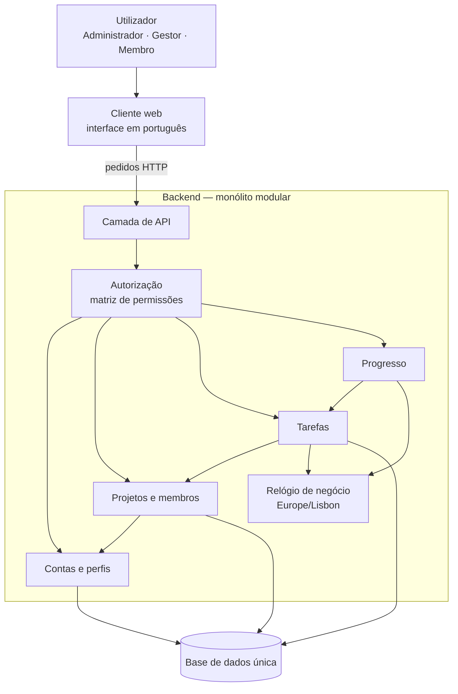

# Matriz — Arquitetura

Versão 0.4 · 29 de outubro de 2026 · Ficha Prática 02, Exercício 1 · a 0.3 retirou o acesso direto do Progresso à base de dados (RV-24); a 0.4 regista a stack (Q-14) e a autenticação (Q-22) e ajusta os componentes às decisões da Ficha 3 (Q-15 a Q-20).

> **Estado: proposta, por aprovar pela dona do produto (R-06).** Este documento decide o estilo de arquitetura, os componentes do MVP e a stack (secção 3.1). O alojamento continua pendente ([constraints.md](constraints.md#4-decisões-técnicas-pendentes)). Os pressupostos novos estão na secção 6, separados dos requisitos confirmados.

## 1. Fatores que pesam na decisão

Retirados da especificação; nenhum é novo.

| Fator | Origem | Efeito na arquitetura |
|---|---|---|
| Aplicação web, interna, de uma só empresa | RNF-05, G-01, G-02 | Não há multi-tenancy nem exposição pública a gerir. |
| Piloto de 10 a 20 utilizadores; volume por definir | RNF-06, R-04 | Carga baixa; não há necessidade de escalar partes do sistema em separado. |
| Prazo de 3 meses para o piloto | R-05 | Favorece a solução com menos peças para construir, testar e pôr em produção. |
| Regras que cruzam áreas diferentes | A-14, A-16, A-17, A-18, RF-30, Q-04 | Precisam de alterações atómicas sobre contas, projetos e tarefas ao mesmo tempo. |
| Alterações de acesso com efeito no pedido seguinte | RF-01, RV-09 | A autorização tem de consultar o estado atual em cada pedido, não um estado copiado. |
| Matriz de permissões detalhada, por perfil e por papel no projeto | RNF-04, secção 3 de requirements.md | Convém um único ponto onde as permissões são verificadas. |
| Desempenho e disponibilidade por definir | RNF-08 | Não há requisito que justifique distribuir o sistema. |

## 2. Comparação das alternativas

| Critério | Monólito | Monólito modular | Microservices |
|---|---|---|---|
| **Descrição** | Uma aplicação e uma base de dados, sem fronteiras internas formais. | Uma aplicação e uma base de dados, dividida em módulos com responsabilidades e interfaces definidas. | Vários serviços independentes, cada um com os seus dados, a comunicar pela rede. |
| **Esforço para o prazo de 3 meses (R-05)** | Baixo | Baixo a médio | Alto: infraestrutura, comunicação entre serviços, observabilidade |
| **Regras entre áreas (A-16, A-17, RF-30, A-14)** | Simples: uma transação | Simples: uma transação, através das interfaces dos módulos | Difícil: transações distribuídas ou consistência eventual |
| **Efeito imediato de RV-09** | Simples | Simples | Cada serviço tem de confirmar o estado da conta noutro serviço |
| **Escala do piloto (10–20 pessoas)** | Mais do que suficiente | Mais do que suficiente | Desproporcionada |
| **Organização e manutenção** | Tende a misturar responsabilidades à medida que cresce | Boa: cada módulo corresponde a uma área funcional | Boa, mas com custo operacional elevado |
| **Trabalho com assistentes de IA** | Contexto difuso | Cada tarefa fica contida num módulo e nos seus RF | Contexto repartido por vários repositórios ou serviços |
| **Evolução futura (RF-19 a RF-26)** | Requer reorganização | Novos módulos (ex.: notificações, RF-25) encaixam sem mexer nos existentes | Fácil de acrescentar serviços, mas sem necessidade prevista |

## 3. Decisão

**Monólito modular**: uma aplicação web com um único backend dividido em módulos por área funcional e uma única base de dados.

**Justificação:**
1. **Escala e prazo.** Um piloto de 10 a 20 pessoas em 3 meses (R-04, R-05) não justifica o custo de microservices. Nenhum RNF exige escalar ou implementar partes do sistema em separado.
2. **Consistência das regras.** Várias regras cruzam contas, projetos e tarefas: desativar um Gestor exige que não tenha projetos (A-16, Q-07); remover um membro deixa as suas tarefas sem responsável (A-14); uma transferência muda o Gestor e mantém o anterior como membro (RF-30, Q-04). Com uma só base de dados, cada uma é uma transação.
3. **Segurança.** A matriz de permissões (RNF-04) e o efeito imediato das alterações de acesso (RV-09) ficam garantidos num único ponto de verificação, sobre dados sempre atuais.
4. **Porquê modular e não um monólito simples.** As fronteiras entre módulos acompanham as áreas de requirements.md, o que facilita testar cada US em isolamento, limita o âmbito de cada alteração (AGENTS.md, regra 4) e permite acrescentar as funcionalidades fora do âmbito sem reorganizar o código.

**Consequência aceite:** a aplicação é implementada e posta em produção como um todo. Se no futuro algum módulo precisar de escalar em separado, as fronteiras modulares permitem extraí-lo.

### 3.1 Stack (Q-14)

Decidida na conciliação com a Ficha 3. Escolhida por ser simples de instalar (um só runtime, uma base de dados num ficheiro) e por usar a mesma linguagem no backend e no frontend.

| Camada | Escolha | Estado |
|---|---|---|
| Runtime e linguagem | Node.js 24 LTS e TypeScript, no backend e no frontend | Decidido (Q-14) |
| Backend | Express | Decidido (Q-14) |
| Frontend | React com Vite | Decidido (Q-14) |
| Base de dados | SQLite, num ficheiro local | Decidido (Q-14) |
| Testes | Vitest; Supertest para os pedidos HTTP ao backend | Decidido (Q-14) |
| Acesso à base de dados | `better-sqlite3`, com SQL escrito à mão e migrations em ficheiros `.sql` | Aprovado (P1) |
| Validação dos pedidos | `zod` | Aprovado (P1) |
| Hash da palavra-passe | `bcryptjs` | Aprovado (P1) |
| Navegação no frontend | React Router | Aprovado (P1) |

**Autenticação (Q-22).** Email e palavra-passe. Ao entrar, o backend cria uma linha em SESSAO e devolve um cookie httpOnly com um identificador aleatório; na base de dados guarda-se só o hash desse identificador. Em cada pedido, a camada de API lê o cookie, encontra a sessão e passa o utilizador à Autorização, que relê a conta, os perfis e os papéis. Assim, desativar uma conta ou perder um papel tem efeito no pedido seguinte (RV-09). Terminar a sessão apaga a linha.

**Organização do repositório:** uma pasta `backend/` e uma pasta `frontend/`, com os módulos da secção 4 em `backend/src/modulos/`. A estrutura completa está em [implementation-plan.md](implementation-plan.md#3-estrutura-prevista).

## 4. Componentes e responsabilidades

| Componente | Responsabilidades | RF / regras |
|---|---|---|
| **Cliente web** | Ecrãs da aplicação em português. Mostra só as ações permitidas ao utilizador, mas não é ele que garante as permissões. Pede confirmação antes de eliminar uma tarefa ou um projeto. Traduz os códigos técnicos de estado e prioridade (Q-21). | RNF-01, RNF-05, A-10, Q-19, Q-21 |
| **Camada de API** | Recebe os pedidos, identifica o utilizador autenticado a partir do cookie de sessão, valida o formato dos dados e os limites de tamanho, e devolve erros claros. Nunca aceita do cliente a identidade, o autor de um comentário nem a data. | RNF-03, Q-01, Q-03, Q-22 |
| **Autorização** | Verifica, em cada pedido, se a conta está ativa e se o utilizador tem o perfil ou o papel no projeto necessário (Gestor do projeto, membro, responsável). Bloqueia alterações em projetos arquivados. Lê sempre o estado atual. | RF-01, RNF-04, RV-09, D-09, D-05, A-02 |
| **Contas e perfis** | Iniciar e terminar sessão e validar a sessão de cada pedido (Q-22). Criar contas com palavra-passe inicial, atribuir e retirar perfis, desativar e reativar contas. Garante o email único, o perfil Membro permanente, pelo menos 1 Administrador ativo e que o Administrador não se atribui o perfil Gestor. Antes de desativar ou retirar o perfil Gestor, verifica se o utilizador ainda gere algum projeto, através de uma interface definida pelo próprio módulo de Contas (ver as regras entre módulos). | RF-01 a RF-03, RV-01, RV-02, RV-11, RV-18, A-16 a A-18 |
| **Projetos e membros** | Criar projetos com o Gestor indicado e eliminar projetos sem tarefas (Administrador); editar, arquivar e desarquivar projetos; gerir membros; lista e pesquisa de projetos do utilizador; transferência de projetos e a vista restrita do Administrador (nome e Gestor). | RF-04 a RF-08, RF-30, RF-32, RF-33, A-02 a A-06, A-14, Q-04 a Q-06, Q-18, Q-19 |
| **Tarefas** | Criar, editar e eliminar tarefas; adicionar e remover responsáveis, juntar-se e sair; mudar o estado; lista de tarefas com filtros; comentários. Aplica as regras de edição por perfil. | RF-09 a RF-15, RF-22, RF-24, RF-34, A-07, A-11, A-15, A-19, Q-15, Q-20 |
| **Progresso** | Calcula, a partir das tarefas lidas através da interface do módulo de Tarefas (RV-24), a contagem por estado, a percentagem concluída (arredondada às décimas, máximo 99,9% até tudo estar concluído, "Sem tarefas") e as tarefas em atraso. Fornece as contagens do painel inicial. Não guarda dados próprios. | RF-16 a RF-18, RF-35, A-08, A-09, RV-12 |
| **Relógio de negócio** | Fornece o dia de hoje no fuso Europe/Lisbon a todas as regras que dependem da data. Isolado para os testes poderem fixar a data. | RNF-02, A-08 |
| **Base de dados única** | SQLite (Q-14). Guarda contas, perfis, sessões, projetos, membros, tarefas, atribuições e comentários. As alterações que cruzam módulos são feitas numa só transação. | RNF-07, RNF-09, D-02, R-12 |

**Regras entre módulos:**
- Os módulos só comunicam pelas interfaces uns dos outros, nunca pelas tabelas de outro módulo.
- As dependências seguem um só sentido: Progresso → Tarefas → Projetos → Contas.
- A verificação de A-16/A-17 precisa que Contas saiba se o utilizador ainda gere projetos. Para não criar a dependência Contas → Projetos, o módulo de Contas **define** a interface de que precisa ("este utilizador gere algum projeto, ativo ou arquivado?") e o módulo de Projetos **implementa-a**. Contas depende só da sua própria interface; o sentido Projetos → Contas mantém-se.
- A autorização é verificada no backend em todos os pedidos; o cliente web nunca é a única barreira.

## 5. O que esta decisão não resolve

A stack, o método de autenticação e o mecanismo para RV-09 ficaram decididos na secção 3.1. A estratégia de testes está em [implementation-plan.md](implementation-plan.md).

Continuam pendentes, conforme [constraints.md](constraints.md#4-decisões-técnicas-pendentes):
- Alojamento da aplicação e localização dos dados.
- Regras para as palavras-passe e duração da sessão (aprovadas em P2 e P3, [implementation-plan.md](implementation-plan.md#2-propostas-técnicas-aprovadas)).
- Valores de desempenho, disponibilidade e acessibilidade (RNF-08).
- Registo de auditoria, cópias de segurança e requisitos legais de proteção de dados (RV-04).

## 6. Pressupostos desta proposta (por aprovar)

- O cliente web e o backend comunicam por uma API HTTP (base para o `openapi.yaml` do Exercício 3).
- O progresso é calculado no momento do pedido, sem valores guardados, por o volume do piloto ser baixo (RNF-06). A rever quando o volume de projetos e tarefas for definido.
- Uma única base de dados SQLite serve todos os módulos.
- A verificação de A-16/A-17 usa uma interface definida por Contas e implementada por Projetos, para manter as dependências num só sentido (secção 4).
- Da mesma forma, para eliminar um projeto (Q-19), o módulo de Projetos define a interface "este projeto tem tarefas?" e o módulo de Tarefas implementa-a. A chave estrangeira `RESTRICT` de [database.md](database.md#5-mapeamento-para-sqlite-q-14) é uma segunda barreira.
- O backend serve a API em `/api`; em desenvolvimento, o Vite encaminha `/api` para o backend, para que o cookie de sessão funcione sem configurar CORS.
