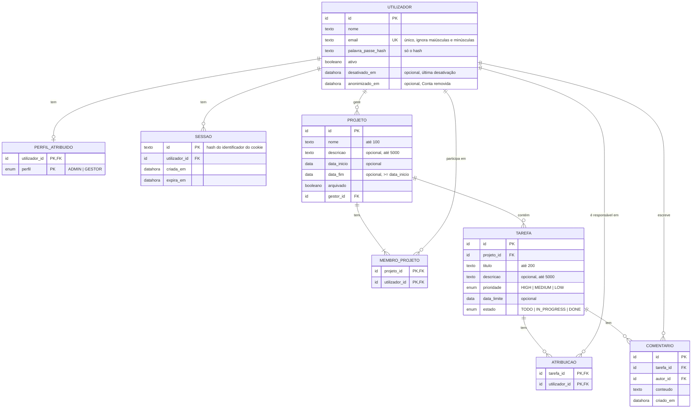

# Matriz — Modelo de dados

Versão 0.7 · 8 de novembro de 2026 · Ficha Prática 02, Exercício 2 · a 0.2 acrescentou a regra 15 (Q-12) e clarificou o email no diagrama (RV-30); a 0.3 aplica a conciliação com a Ficha 3: palavra-passe e sessões (Q-22), vários responsáveis (Q-20), comentários (Q-15), eliminação de projetos (Q-19), códigos técnicos (Q-21) e o mapeamento para SQLite (Q-14); a 0.4 (1 de novembro de 2026) aplica RV-31: um só projeto ativo para quem não tem o perfil Gestor (regra 19) e remoção de membros num projeto arquivado (regra 11); aplica RV-32: o Administrador nunca é membro (regra 20) e não acumula perfis; regista RV-33 (anonimização das contas desativadas, a implementar no I3); a 0.5 acrescenta `desativado_em` e `anonimizado_em` a UTILIZADOR (I3, migration 002, P27); a 0.6 corrige a cardinalidade dos perfis para 0..1 (RV-32), acrescenta ao diagrama ER as colunas da 0.5 e atualiza as referências ao I3, já concluído; a 0.7 (8 de novembro de 2026) acrescenta FALHA_ENTRADA e a regra 22 (RV-35, migration 003, P29).

> **Estado: proposta, por aprovar pela dona do produto (R-06).** Modelo dos dados do MVP (RF-01 a RF-18, RF-22, RF-24, RF-30, RF-32 a RF-35), coerente com a arquitetura de [architecture.md](architecture.md): uma base de dados única (SQLite, Q-14), partilhada pelos módulos Contas, Projetos e Tarefas. As secções 1 a 4 são o modelo conceptual; a secção 5 mapeia-o para SQLite. Os pressupostos por aprovar estão na secção 6; as questões já decididas, na secção 7.

## 1. Entidades

### UTILIZADOR — conta individual (RF-01 a RF-03)

| Atributo | Tipo | Obrigatório | Regras | Origem |
|---|---|---|---|---|
| `id` | identificador | Sim | Identificador técnico, chave primária. | — |
| `nome` | texto | Sim | | A-21, Q-08 |
| `email` | texto | Sim | Único entre todas as contas, ativas ou desativadas, sem distinguir maiúsculas de minúsculas. | RV-18, Q-10, EC-33 |
| `palavra_passe_hash` | texto | Sim | Hash da palavra-passe; a palavra-passe nunca é guardada em claro nem devolvida pela API. | Q-22, EC-49 |
| `ativo` | booleano | Sim | `verdadeiro` ao criar. A conta nunca é apagada no MVP; desativar e reativar muda só este campo. | RF-03, D-02, RV-18 |
| `desativado_em` | data e hora | Não | Momento da última desativação; vazio numa conta ativa. Conta o ano de RV-33. | RV-33, RV-34, P27 |
| `anonimizado_em` | data e hora | Não | Momento da anonimização; preenchido, a conta mostra-se como "Conta removida" e não pode ser reativada. | RV-33, RV-34, P27 |

No MVP, uma conta tem nome, email e o hash da palavra-passe (Q-08, Q-22).

### PERFIL_ATRIBUIDO — perfis globais de cada utilizador (RF-02)

| Atributo | Tipo | Obrigatório | Regras | Origem |
|---|---|---|---|---|
| `utilizador_id` | identificador | Sim | Chave estrangeira para UTILIZADOR. Parte da chave primária. | — |
| `perfil` | enumerado | Sim | `ADMIN` ou `GESTOR` (códigos técnicos, P7). Parte da chave primária. | R-08, D-04 |

O perfil **Membro** não é guardado: todos os utilizadores, exceto os Administradores, o têm e não pode ser retirado (RV-02, RV-32). Um utilizador pode ter 0 ou 1 linha nesta tabela: o perfil Administrador não se acumula com o perfil Gestor (D-04, RV-32). É garantido pelo módulo Contas desde o I3 (`PERFIS_INCOMPATIVEIS`, P25).

### SESSAO — sessões iniciadas (RF-01)

| Atributo | Tipo | Obrigatório | Regras | Origem |
|---|---|---|---|---|
| `id` | texto | Sim | Hash do identificador aleatório enviado no cookie; o identificador em claro não é guardado. Chave primária. | Q-22 |
| `utilizador_id` | identificador | Sim | Chave estrangeira para UTILIZADOR. | Q-22 |
| `criada_em` | data e hora | Sim | Obtida no servidor. | Q-22 |
| `expira_em` | data e hora | Sim | Renovada a cada pedido; expira após 8 horas sem atividade (P2). | Q-22 |

Terminar a sessão apaga a linha. A sessão só identifica o utilizador: a conta, os perfis e os papéis são relidos em cada pedido (RV-09).

### FALHA_ENTRADA — tentativas de entrada falhadas (RF-01, RV-35)

| Atributo | Tipo | Obrigatório | Regras | Origem |
|---|---|---|---|---|
| `id` | identificador | Sim | Identificador técnico, chave primária. | — |
| `email` | texto | Sim | Email indicado no pedido, sem espaços nas pontas e em minúsculas. Não é chave estrangeira: conta também emails sem conta, para o bloqueio não revelar que contas existem (CA-01.3, EC-20). | RV-35, P29 |
| `ocorrida_em` | data e hora | Sim | Obtida no servidor. | RV-35, P29 |

Não se relaciona com as outras entidades. As regras estão na secção 4 (regra 22).

### PROJETO (RF-04 a RF-08, RF-30, RF-32)

| Atributo | Tipo | Obrigatório | Regras | Origem |
|---|---|---|---|---|
| `id` | identificador | Sim | Chave primária. | — |
| `nome` | texto | Sim | Até 100 caracteres; só espaços conta como vazio. | D-06, A-20, Q-01, RV-15 |
| `descricao` | texto | Não | Até 5000 caracteres. | R-12, A-20 |
| `data_inicio` | data | Não | | R-12 |
| `data_fim` | data | Não | Se ambas as datas existirem, `data_fim >= data_inicio`. | R-12, A-12 |
| `arquivado` | booleano | Sim | `falso` ao criar. | RF-07, D-09 |
| `gestor_id` | identificador | Sim | Chave estrangeira para UTILIZADOR. Indicado pelo Administrador ao criar; um só Gestor por projeto; muda na transferência. | D-03, A-03, RF-30, Q-18 |

Um projeto só é apagado se não tiver tarefas (Q-19, RF-32).

### MEMBRO_PROJETO — quem pertence a cada projeto (RF-06)

| Atributo | Tipo | Obrigatório | Regras | Origem |
|---|---|---|---|---|
| `projeto_id` | identificador | Sim | Chave estrangeira para PROJETO. Parte da chave primária. | R-07 |
| `utilizador_id` | identificador | Sim | Chave estrangeira para UTILIZADOR. Parte da chave primária. | R-07 |

Só se adicionam utilizadores com conta ativa (A-21, Q-11). Remover um membro apaga a linha correspondente. Contas desativadas mantêm as linhas que já tinham (EC-32).

### TAREFA (RF-09 a RF-15, RF-22)

| Atributo | Tipo | Obrigatório | Regras | Origem |
|---|---|---|---|---|
| `id` | identificador | Sim | Chave primária. | — |
| `projeto_id` | identificador | Sim | Chave estrangeira para PROJETO. Não há tarefas fora de projetos. | R-07 |
| `titulo` | texto | Sim | Até 200 caracteres; só espaços conta como vazio. | R-10, A-20, Q-01 |
| `descricao` | texto | Não | Até 5000 caracteres. | R-10, A-20 |
| `prioridade` | enumerado | Sim | `HIGH`, `MEDIUM` ou `LOW`; por omissão `MEDIUM`. | D-19, A-19, Q-21 |
| `data_limite` | data | Não | Pode estar no passado. | A-07 |
| `estado` | enumerado | Sim | `TODO`, `IN_PROGRESS` ou `DONE`; sempre `TODO` ao criar. | R-11, D-13, Q-21 |

Os responsáveis passaram para ATRIBUICAO (Q-20). Eliminar uma tarefa apaga a linha de forma definitiva, com as suas atribuições e comentários (A-10, RNF-07).

### ATRIBUICAO — responsáveis de cada tarefa (RF-10)

| Atributo | Tipo | Obrigatório | Regras | Origem |
|---|---|---|---|---|
| `tarefa_id` | identificador | Sim | Chave estrangeira para TAREFA. Parte da chave primária. | Q-20 |
| `utilizador_id` | identificador | Sim | Chave estrangeira para UTILIZADOR. Parte da chave primária, o que impede atribuições repetidas. | Q-20, EC-43 |

### COMENTARIO (RF-24)

| Atributo | Tipo | Obrigatório | Regras | Origem |
|---|---|---|---|---|
| `id` | identificador | Sim | Chave primária. | — |
| `tarefa_id` | identificador | Sim | Chave estrangeira para TAREFA. | Q-15 |
| `autor_id` | identificador | Sim | Chave estrangeira para UTILIZADOR. Obtido da sessão, nunca do pedido. | Q-15, EC-45 |
| `conteudo` | texto | Sim | Só espaços conta como vazio; limite em RNF-03. | Q-01, Q-15, EC-44 |
| `criado_em` | data e hora | Sim | Obtida no servidor, nunca do pedido. | Q-15, EC-45 |

## 2. Relacionamentos e cardinalidades

| Relacionamento | Cardinalidade | Regras | Origem |
|---|---|---|---|
| UTILIZADOR **tem** PERFIL_ATRIBUIDO | 1 : 0..1 | Cada utilizador tem, no máximo, um perfil guardado (`ADMIN` ou `GESTOR`): os dois não se acumulam. | D-04, RV-02, RV-32 |
| UTILIZADOR **tem** SESSAO | 1 : 0..N | Um utilizador pode ter várias sessões abertas (por exemplo, em dois navegadores). | Q-22 |
| UTILIZADOR **gere** PROJETO | 1 : 0..N | Cada projeto tem exatamente 1 Gestor; um Gestor pode gerir vários projetos. | D-03, A-03 |
| PROJETO **tem** MEMBRO_PROJETO | 1 : 1..N | Um projeto tem sempre pelo menos 1 membro: o seu Gestor. | A-01, Q-05 |
| UTILIZADOR **participa em** MEMBRO_PROJETO | 1 : 0..N | Quem tem o perfil Gestor pode estar em vários projetos; quem não o tem está, no máximo, em 1 projeto ativo (regra 19). | R-07, RV-31 |
| PROJETO **contém** TAREFA | 1 : 0..N | Cada tarefa pertence a exatamente 1 projeto. | R-07 |
| TAREFA **tem** ATRIBUICAO | 1 : 0..N | Uma tarefa tem zero, um ou vários responsáveis. | Q-20 |
| UTILIZADOR **é responsável em** ATRIBUICAO | 1 : 0..N | Um utilizador pode ser responsável por várias tarefas. | Q-20 |
| TAREFA **tem** COMENTARIO | 1 : 0..N | Cada comentário pertence a exatamente 1 tarefa. | Q-15 |
| UTILIZADOR **escreve** COMENTARIO | 1 : 0..N | Cada comentário tem exatamente 1 autor. | Q-15 |

## 3. Diagrama ER

## 4. Regras de negócio sobre os dados

Regras que o diagrama não mostra e que têm de ser garantidas pelos módulos ou por restrições da base de dados (secção 5).

**Integridade entre entidades**
1. O Gestor de um projeto é sempre membro desse projeto: existe a linha (`projeto.id`, `projeto.gestor_id`) em MEMBRO_PROJETO (A-01). Ao criar o projeto, essa linha é criada na mesma transação (Q-18). Essa linha não pode ser removida (Q-05, EC-28).
2. O `gestor_id` de um projeto tem o perfil Gestor, conta ativa no momento da indicação e não tem o perfil Administrador (D-03, Q-18, RV-01). Retirar o perfil Gestor, ou desativar a conta, só é possível depois de transferir todos os projetos, ativos e arquivados (A-16, A-17, Q-07, EC-23, EC-26).
3. Cada responsável de uma tarefa é membro do projeto da tarefa (D-12, EC-03) e, no momento da atribuição, tem conta ativa (A-15, EC-22). A mesma atribuição não se repete (Q-20, EC-43).
4. Remover um membro de um projeto apaga as suas linhas de ATRIBUICAO nas tarefas desse projeto, na mesma transação; as outras atribuições mantêm-se (A-14, Q-20, EC-19).
5. Desativar uma conta não altera ATRIBUICAO, MEMBRO_PROJETO nem COMENTARIO; o aviso "conta desativada" vem de `utilizador.ativo` (A-15, EC-21, CA-04.2). Desativar uma conta apaga as suas sessões.
6. Existe sempre pelo menos 1 utilizador com `ativo = verdadeiro` e o perfil Administrador (A-18, EC-27).
7. O Administrador não atribui a si próprio o perfil Gestor (RV-01, EC-36).

**Transferência de projeto (RF-30)**

8. A transferência muda `projeto.gestor_id`, numa só transação. O destino tem perfil Gestor, conta ativa e não tem perfil Administrador (D-22, RV-01, RV-13, EC-24, EC-35).
9. O Gestor anterior mantém a sua linha em MEMBRO_PROJETO e as suas atribuições (Q-04, EC-25).
10. Se o novo Gestor ainda não for membro, a mesma transação acrescenta a linha (`projeto.id`, novo `gestor_id`) em MEMBRO_PROJETO, para cumprir a regra 1 (A-01, Q-09).

**Projetos arquivados**

11. Com `arquivado = verdadeiro`, os dados do projeto, dos seus membros, das suas tarefas, atribuições e comentários não mudam. As únicas exceções são desarquivar, transferir, eliminar um projeto sem tarefas e remover membros, que apaga as suas atribuições nesse projeto (regra 4) (D-09, A-04, A-05, Q-19, RV-31, EC-16).

**Eliminações**

12. Eliminar um projeto só é possível se não tiver tarefas; apaga o projeto e as suas linhas de MEMBRO_PROJETO, na mesma transação (Q-19, EC-40).
13. Eliminar uma tarefa apaga a tarefa, as suas atribuições e os seus comentários, na mesma transação (RF-22, Q-15, Q-20).

**Dados derivados (não guardados)**

14. O progresso (contagem por estado, percentagem concluída e tarefas em atraso) é calculado a partir de TAREFA e não é guardado (RF-16 a RF-18, ver [architecture.md](architecture.md#6-pressupostos-desta-proposta-por-aprovar)).
15. Uma tarefa está em atraso quando `data_limite` é anterior ao dia de hoje em Europe/Lisbon e `estado` é diferente de `DONE` (D-18, A-08). O atraso não é guardado.
16. A ordem da lista de projetos (ativos primeiro, depois arquivados) vem de `arquivado` (A-06).
17. A ordem da lista de tarefas e da lista em atraso vem de `estado` e `data_limite` (Q-12); não exige atributos novos.
18. A ordem dos comentários vem de `criado_em` e, em caso de empate, de `id` (RF-24).

**Membros sem o perfil Gestor**

19. Um utilizador sem o perfil Gestor tem, no máximo, uma linha em MEMBRO_PROJETO num projeto com `arquivado = falso`. É garantido pelo módulo Projetos, ao adicionar um membro (EC-52) e ao desarquivar (EC-53); não há restrição na base de dados, porque depende do perfil e do arquivo (R-07, RV-31).
20. Um utilizador com o perfil Administrador nunca tem linhas em MEMBRO_PROJETO. É garantido pelo módulo Projetos ao adicionar membros (EC-30) e pelo módulo Contas ao atribuir perfis, através da interface `ConsultaProjetos` (EC-55, RV-32, RV-34).
21. Um ano depois de `desativado_em`, a conta é anonimizada: `nome` passa a "Conta removida", `email` a `removida-<id>@matriz.invalid`, `palavra_passe_hash` a um valor que não corresponde a nenhuma palavra-passe, e os perfis e as sessões são apagados; `anonimizado_em` fica preenchido. As linhas de MEMBRO_PROJETO, ATRIBUICAO e COMENTARIO mantêm-se. Reativar a conta limpa `desativado_em` (RV-33, RV-34, P27).

**Tentativas de entrada**

22. Cada entrada recusada (credenciais erradas, email sem conta ou conta desativada) acrescenta uma linha em FALHA_ENTRADA. Se as 5 falhas mais recentes de um email aconteceram em menos de 15 minutos, a entrada com esse email fica bloqueada durante 15 minutos a contar da última; durante o bloqueio não se acrescentam linhas. Uma entrada com sucesso apaga as linhas desse email; as linhas com mais de 30 minutos já não contam e são apagadas (RV-35, EC-57, P29).

## 5. Mapeamento para SQLite (Q-14)

| Conceito | Em SQLite |
|---|---|
| Nomes | Tabelas e colunas em minúsculas: `utilizador`, `perfil_atribuido`, `sessao`, `projeto`, `membro_projeto`, `tarefa`, `atribuicao`, `comentario`, `falha_entrada`. |
| Identificador | `INTEGER PRIMARY KEY` (exceto `sessao.id`, `TEXT`). A API trata-os como números inteiros. |
| Booleano | `INTEGER` com `CHECK (valor IN (0, 1))`. |
| Data | `TEXT` no formato `AAAA-MM-DD`. |
| Data e hora | `TEXT` em ISO 8601, em UTC; a interface mostra-a em Europe/Lisbon (RNF-02). |
| Enumerado | `TEXT` com `CHECK` sobre os códigos de Q-21. |
| Email único | `UNIQUE` com `COLLATE NOCASE` (Q-10). |
| Chaves estrangeiras | Ativadas em cada ligação (`PRAGMA foreign_keys = ON`). |

**Comportamento das chaves estrangeiras ao apagar:**

| Chave | Ao apagar o registo referido | Porquê |
|---|---|---|
| `tarefa.projeto_id` | `RESTRICT` | A base de dados impede apagar um projeto com tarefas (regra 12, Q-19). |
| `membro_projeto.projeto_id` | `CASCADE` | Apagar um projeto sem tarefas apaga os seus membros (regra 12). |
| `atribuicao.tarefa_id`, `comentario.tarefa_id` | `CASCADE` | Apagar uma tarefa apaga as suas atribuições e comentários (regra 13). |
| `sessao.utilizador_id` e restantes referências a `utilizador` | `RESTRICT` | As contas não são apagadas: um ano depois da desativação são anonimizadas, e as referências mantêm-se (D-02, RV-33, regra 21). |

**Migrations e seed:** o esquema é criado por ficheiros de migration numerados e aplicados por ordem; cada migration é aplicada uma só vez. O seed cria as contas e os projetos de demonstração só se a base de dados estiver vazia, para não apagar dados em cada arranque (Ficha 3, Exercício 2). Os ficheiros e comandos estão em [implementation-plan.md](implementation-plan.md).

## 6. Pressupostos deste modelo (por aprovar)

- Os perfis ficam numa tabela à parte (PERFIL_ATRIBUIDO) em vez de campos booleanos na conta, e o perfil Membro não é guardado por ser comum a todos.
- O Gestor do projeto é guardado em PROJETO (`gestor_id`) e também como linha em MEMBRO_PROJETO, para que "membro do projeto" inclua sempre o Gestor (A-01) sem casos especiais.
- As sessões ficam na mesma base de dados, para continuarem válidas depois de reiniciar o backend.
- Só os comentários e as sessões guardam datas de criação. As tarefas e os projetos não, porque nenhum requisito do MVP as pede. O histórico de alterações (RF-23) e o registo de auditoria estão fora do âmbito ou por decidir.
- `COLLATE NOCASE` só ignora maiúsculas e minúsculas em letras sem acentos. Os emails de trabalho não costumam ter acentos; a rever se for preciso.

## 7. Questões levantadas por este modelo

Decididas pela dona do produto, que aceitou as propostas. Registadas em [constraints.md](constraints.md#questões-da-consolidação) e aplicadas em [requirements.md](requirements.md).

| ID | Questão | Decisão | Aplicada em |
|---|---|---|---|
| Q-09 | Numa transferência, o novo Gestor passa a membro do projeto, se ainda não o for? | Sim, na mesma transação (A-01). | RF-30; secção 4, regra 10 |
| Q-10 | A unicidade do email ignora maiúsculas e minúsculas? | Sim. | RF-02; UTILIZADOR.`email` |
| Q-11 | Pode adicionar-se um utilizador desativado como membro de um projeto? | Não; só utilizadores com conta ativa (A-21). | RF-06; MEMBRO_PROJETO |

As decisões da Ficha 3 que mudam este modelo (Q-15, Q-19 a Q-22) estão em [constraints.md](constraints.md#conciliação-com-o-âmbito-da-ficha-3).
