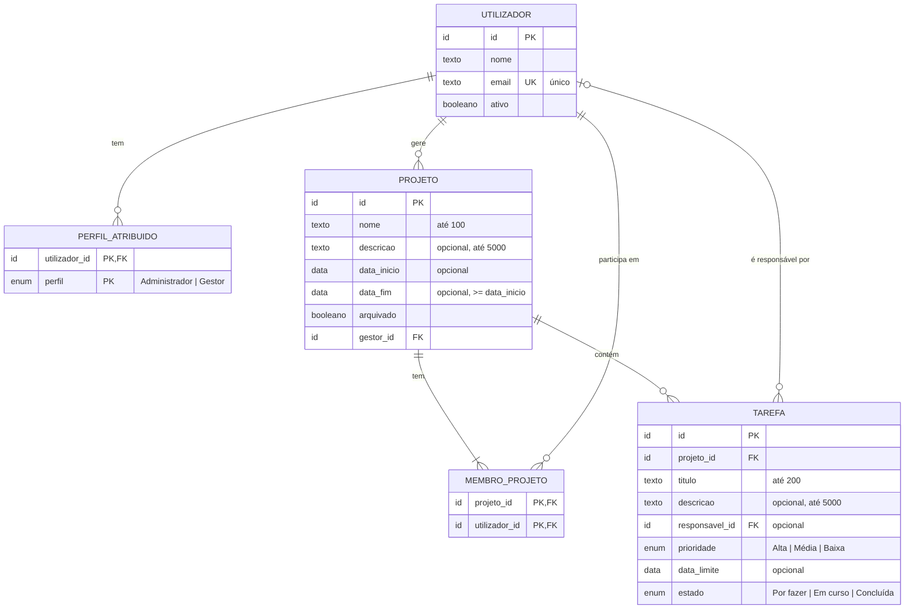

# Matriz — Modelo de dados

Versão 0.1 · 26 de outubro de 2026 · Ficha Prática 02, Exercício 2

> **Estado: proposta, por aprovar pela dona do produto (R-06).** Modelo conceptual dos dados do MVP (RF-01 a RF-18, RF-22, RF-30), coerente com a arquitetura de [architecture.md](architecture.md): uma base de dados única, partilhada pelos módulos Contas, Projetos e Tarefas. Não fixa tecnologia nem tipos físicos: o tipo de base de dados é decidido com a stack ([constraints.md](constraints.md#4-decisões-técnicas-pendentes)). Os pressupostos por aprovar estão na secção 5; as questões levantadas por este modelo, já decididas, na secção 6.

## 1. Entidades

### UTILIZADOR — conta individual (RF-01 a RF-03)

| Atributo | Tipo | Obrigatório | Regras | Origem |
|---|---|---|---|---|
| `id` | identificador | Sim | Identificador técnico, chave primária. | — |
| `nome` | texto | Sim | | A-21, Q-08 |
| `email` | texto | Sim | Único entre todas as contas, ativas ou desativadas, sem distinguir maiúsculas de minúsculas. | RV-18, Q-10, EC-33 |
| `ativo` | booleano | Sim | `verdadeiro` ao criar. A conta nunca é apagada no MVP; desativar e reativar muda só este campo. | RF-03, D-02, RV-18 |

No MVP, uma conta tem apenas nome e email (Q-08). Os dados de autenticação dependem do método de autenticação, ainda por definir, e não fazem parte deste modelo.

### PERFIL_ATRIBUIDO — perfis globais de cada utilizador (RF-02)

| Atributo | Tipo | Obrigatório | Regras | Origem |
|---|---|---|---|---|
| `utilizador_id` | identificador | Sim | Chave estrangeira para UTILIZADOR. Parte da chave primária. | — |
| `perfil` | enumerado | Sim | `Administrador` ou `Gestor`. Parte da chave primária. | R-08, D-04 |

O perfil **Membro** não é guardado: todos os utilizadores o têm e não pode ser retirado (RV-02). Um utilizador pode ter 0, 1 ou 2 linhas nesta tabela (D-04).

### PROJETO (RF-04 a RF-08, RF-30)

| Atributo | Tipo | Obrigatório | Regras | Origem |
|---|---|---|---|---|
| `id` | identificador | Sim | Chave primária. | — |
| `nome` | texto | Sim | Até 100 caracteres; só espaços conta como vazio. | D-06, A-20, Q-01, RV-15 |
| `descricao` | texto | Não | Até 5000 caracteres. | R-12, A-20 |
| `data_inicio` | data | Não | | R-12 |
| `data_fim` | data | Não | Se ambas as datas existirem, `data_fim >= data_inicio`. | R-12, A-12 |
| `arquivado` | booleano | Sim | `falso` ao criar. O projeto nunca é apagado. | RF-07, D-09, R-12 |
| `gestor_id` | identificador | Sim | Chave estrangeira para UTILIZADOR. Um só Gestor por projeto; muda na transferência. | D-03, A-03, RF-30 |

### MEMBRO_PROJETO — quem pertence a cada projeto (RF-06)

| Atributo | Tipo | Obrigatório | Regras | Origem |
|---|---|---|---|---|
| `projeto_id` | identificador | Sim | Chave estrangeira para PROJETO. Parte da chave primária. | R-07 |
| `utilizador_id` | identificador | Sim | Chave estrangeira para UTILIZADOR. Parte da chave primária. | R-07 |

Só se adicionam utilizadores com conta ativa (A-21, Q-11). Remover um membro apaga a linha correspondente. Contas desativadas mantêm as linhas que já tinham (EC-32).

### TAREFA (RF-09 a RF-15, RF-22)

| Atributo | Tipo | Obrigatório | Regras | Origem |
|---|---|---|---|---|
| `id` | identificador | Sim | Chave primária. | — |
| `projeto_id` | identificador | Sim | Chave estrangeira para PROJETO. Não há tarefas fora de projetos. | R-07 |
| `titulo` | texto | Sim | Até 200 caracteres; só espaços conta como vazio. | R-10, A-20, Q-01 |
| `descricao` | texto | Não | Até 5000 caracteres. | R-10, A-20 |
| `responsavel_id` | identificador | Não | Chave estrangeira para UTILIZADOR. Vazio = sem responsável. | R-10, RF-10 |
| `prioridade` | enumerado | Sim | `Alta`, `Média` ou `Baixa`; por omissão `Média`. | D-19, A-19 |
| `data_limite` | data | Não | Pode estar no passado. | A-07 |
| `estado` | enumerado | Sim | `Por fazer`, `Em curso` ou `Concluída`; sempre `Por fazer` ao criar. | R-11, D-13 |

Eliminar uma tarefa apaga a linha de forma definitiva (A-10, RNF-07).

## 2. Relacionamentos e cardinalidades

| Relacionamento | Cardinalidade | Regras | Origem |
|---|---|---|---|
| UTILIZADOR **tem** PERFIL_ATRIBUIDO | 1 : 0..2 | Cada perfil aparece no máximo uma vez por utilizador. | D-04, RV-02 |
| UTILIZADOR **gere** PROJETO | 1 : 0..N | Cada projeto tem exatamente 1 Gestor; um Gestor pode gerir vários projetos. | D-03, A-03 |
| PROJETO **tem** MEMBRO_PROJETO | 1 : 1..N | Um projeto tem sempre pelo menos 1 membro: o seu Gestor. | A-01, Q-05 |
| UTILIZADOR **participa em** MEMBRO_PROJETO | 1 : 0..N | Uma pessoa pode estar em vários projetos. | R-07 |
| PROJETO **contém** TAREFA | 1 : 0..N | Cada tarefa pertence a exatamente 1 projeto. | R-07 |
| UTILIZADOR **é responsável por** TAREFA | 0..1 : 0..N | Uma tarefa tem no máximo 1 responsável. | R-10 |

## 3. Diagrama ER

## 4. Regras de negócio sobre os dados

Regras que o diagrama não mostra e que têm de ser garantidas pelos módulos (ou por restrições da base de dados, conforme a stack).

**Integridade entre entidades**
1. O Gestor de um projeto é sempre membro desse projeto: existe a linha (`projeto.id`, `projeto.gestor_id`) em MEMBRO_PROJETO (A-01). Por isso essa linha não pode ser removida (Q-05, EC-28).
2. O `gestor_id` de um projeto tem o perfil Gestor (D-03). Retirar esse perfil, ou desativar a conta, só é possível depois de transferir todos os projetos, ativos e arquivados (A-16, A-17, Q-07, EC-23, EC-26).
3. O responsável de uma tarefa é membro do projeto da tarefa (D-12, EC-03) e, no momento da atribuição, tem conta ativa (A-15, EC-22).
4. Remover um membro de um projeto deixa sem responsável todas as tarefas desse projeto de que ele era responsável, na mesma transação (A-14, EC-19).
5. Desativar uma conta não altera `responsavel_id` nem MEMBRO_PROJETO; o aviso "conta desativada" vem de `utilizador.ativo` (A-15, EC-21, CA-04.2).
6. Existe sempre pelo menos 1 utilizador com `ativo = verdadeiro` e o perfil Administrador (A-18, EC-27).
7. O Administrador não atribui a si próprio o perfil Gestor (RV-01, EC-36).

**Transferência de projeto (RF-30)**

8. A transferência muda `projeto.gestor_id`, numa só transação. O destino tem perfil Gestor, conta ativa e não tem perfil Administrador (D-22, RV-01, RV-13, EC-24, EC-35).
9. O Gestor anterior mantém a sua linha em MEMBRO_PROJETO e as tarefas de que é responsável (Q-04, EC-25).
10. Se o novo Gestor ainda não for membro, a mesma transação acrescenta a linha (`projeto.id`, novo `gestor_id`) em MEMBRO_PROJETO, para cumprir a regra 1 (A-01, Q-09).

**Projetos arquivados**

11. Com `arquivado = verdadeiro`, os dados do projeto, dos seus membros e das suas tarefas não mudam. As únicas exceções são desarquivar e transferir (D-09, A-04, A-05, EC-16).

**Dados derivados (não guardados)**

12. O progresso (contagem por estado, percentagem concluída e tarefas em atraso) é calculado a partir de TAREFA e não é guardado (RF-16 a RF-18, ver [architecture.md](architecture.md#6-pressupostos-desta-proposta-por-aprovar)).
13. Uma tarefa está em atraso quando `data_limite` é anterior ao dia de hoje em Europe/Lisbon e `estado` é diferente de `Concluída` (D-18, A-08). O atraso não é guardado.
14. A ordem da lista de projetos (ativos primeiro, depois arquivados) vem de `arquivado` (A-06).

## 5. Pressupostos deste modelo (por aprovar)

- Os perfis ficam numa tabela à parte (PERFIL_ATRIBUIDO) em vez de campos booleanos na conta, e o perfil Membro não é guardado por ser comum a todos.
- O Gestor do projeto é guardado em PROJETO (`gestor_id`) e também como linha em MEMBRO_PROJETO, para que "membro do projeto" inclua sempre o Gestor (A-01) sem casos especiais.
- Os dados de autenticação ficam fora deste modelo até ser escolhido o método de autenticação.
- Não se guardam datas de criação ou de alteração, porque nenhum requisito do MVP as pede. O histórico de alterações (RF-23) e o registo de auditoria estão fora do âmbito ou por decidir.

## 6. Questões levantadas por este modelo

Decididas pela dona do produto, que aceitou as propostas. Registadas em [constraints.md](constraints.md#questões-da-consolidação) e aplicadas em [requirements.md](requirements.md).

| ID | Questão | Decisão | Aplicada em |
|---|---|---|---|
| Q-09 | Numa transferência, o novo Gestor passa a membro do projeto, se ainda não o for? | Sim, na mesma transação (A-01). | RF-30; secção 4, regra 10 |
| Q-10 | A unicidade do email ignora maiúsculas e minúsculas? | Sim. | RF-02; UTILIZADOR.`email` |
| Q-11 | Pode adicionar-se um utilizador desativado como membro de um projeto? | Não; só utilizadores com conta ativa (A-21). | RF-06; MEMBRO_PROJETO |
