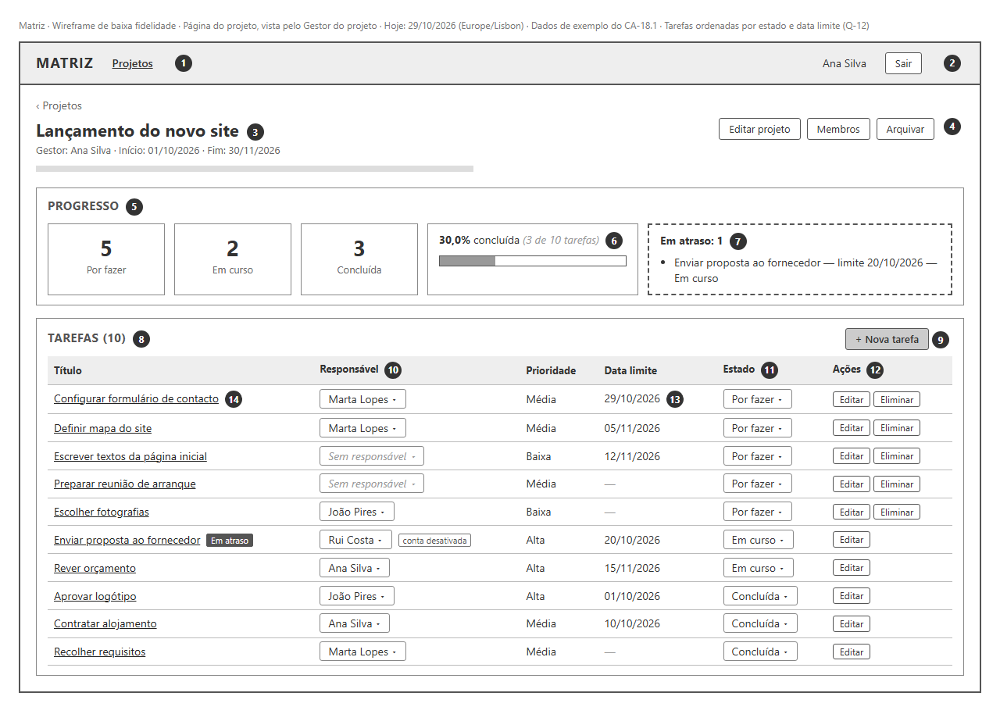

# Matriz — Wireframe da página do projeto

Versão 0.2 · 29 de outubro de 2026 · Ficha Prática 02, Exercícios 4 e 5 · a 0.2 aplica a revisão crítica (RV-27, RV-28, Q-12, Q-13).

> **Estado: proposta, por aprovar pela dona do produto (R-06).** Wireframe de baixa fidelidade de um ecrã do MVP. Não define cores, tipografia nem tecnologia. Os pressupostos de navegação e de interação estão na secção 5, separados dos requisitos.

- Imagem: [wireframe.png](wireframe.png).
- Fonte editável: [wireframe.html](wireframe.html). A imagem foi gerada a partir deste ficheiro, com um navegador em modo headless, a 1280 px de largura.

## 1. Escolha do ecrã

A ficha sugere o dashboard como exemplo. No MVP não há um dashboard com vários projetos: a visão geral do Gestor é o RF-20, fora do âmbito. Por isso, o ecrã escolhido é a **página do projeto**, que junta o progresso (RF-16 a RF-18) e a lista de tarefas (RF-15). É o ecrã central da primeira versão (R-03).

O wireframe mostra o ecrã **visto pelo Gestor do projeto**, que é quem tem mais ações disponíveis. A secção 3 descreve o que muda para os outros papéis.

**Dados de exemplo:** são os do CA-18.1 (10 tarefas: 5 "Por fazer", 2 "Em curso", 3 "Concluída", 30,0%). O dia de hoje é 29/10/2026, em Europe/Lisbon (RNF-02).

## 2. Elementos e requisitos

Os números correspondem aos círculos da imagem.

| # | Elemento | Requisitos e critérios |
|---|---|---|
| 1 | Navegação com uma só entrada, "Projetos", que leva à lista de projetos do utilizador | RF-08, CA-01.1, CA-09.1 |
| 2 | Nome do utilizador com sessão iniciada e "Sair" | RF-01 |
| 3 | Nome, Gestor, datas opcionais e descrição do projeto | RF-04, R-12 |
| 4 | Ações do Gestor sobre o projeto: editar, gerir membros, arquivar | RF-05, RF-06, RF-07 |
| 5 | Contagem de tarefas por estado | RF-16, CA-18.1 |
| 6 | Percentagem concluída, arredondada às décimas, com o total de tarefas | RF-17, A-09, RV-12, CA-18.1 |
| 7 | Quantas e quais tarefas estão em atraso | RF-18, CA-19.1 |
| 8 | Lista de tarefas com título, responsável, prioridade, data limite e estado, ordenada por estado e, dentro de cada estado, por data limite crescente (sem data no fim) | RF-15, CA-17.1, CA-17.3, Q-12 |
| 9 | Criar tarefa (só o Gestor) | RF-09, D-11, EC-05 |
| 10 | Responsável: escolher, mudar ou retirar. Só aparecem membros ativos do projeto, incluindo o Gestor. Um responsável desativado mantém-se, com o aviso "conta desativada" | RF-10, A-15, CA-12.1 a CA-12.4, EC-21, EC-22 |
| 11 | Mudar o estado, para qualquer um dos três | RF-11, RF-12, CA-13.2, CA-13.4 |
| 12 | "Editar" abre todos os campos da tarefa (Gestor). "Eliminar" só aparece em tarefas "Por fazer" | RF-14, RF-22, A-11, EC-13 |
| 13 | Data limite igual a hoje: a tarefa ainda não está em atraso | A-08, EC-07 |
| 14 | O título é um link que abre o detalhe da tarefa, onde se lê a descrição | RF-15, CA-17.2, RV-28 |

Os dados de exemplo também mostram:
- "Contratar alojamento" e "Aprovar logótipo" estão "Concluída" com a data limite ultrapassada e não aparecem em atraso (CA-19.2).
- As tarefas sem data limite não aparecem em atraso (CA-19.3).
- "Enviar proposta ao fornecedor" tem um responsável com a conta desativada e continua atribuída (A-15, EC-21).

## 3. Variações por papel e estado do projeto

Não desenhadas; decorrem da matriz de permissões ([requirements.md](../requirements.md#3-matriz-de-permissões)).

| Situação | O que muda no ecrã |
|---|---|
| **Membro do projeto** (não Gestor) | Não vê "Editar projeto", "Arquivar", "+ Nova tarefa" nem "Eliminar" (RF-05, RF-07, RF-09, RF-22, EC-05, EC-12). "Membros" mostra só os nomes dos membros, sem email e sem adicionar nem remover (RF-06, Q-13, CA-07.3). O responsável aparece como texto. Nas tarefas sem responsável aparece "Atribuir-me", e nas suas tarefas aparece "Largar" (RF-10, US-20, EC-34). Só muda o estado das tarefas de que é responsável (RF-11, CA-13.3, EC-04). "Editar" só aparece nas suas tarefas e só deixa alterar a descrição (RF-13, CA-14.2). Pode abrir qualquer tarefa para ler a descrição (RF-15, CA-17.2). |
| **Administrador membro do projeto** | Igual ao Membro (Q-06, EC-30). |
| **Projeto arquivado** | O projeto aparece marcado como "Arquivado". Todas as ações de alteração desaparecem; o Gestor vê "Desarquivar" no lugar de "Arquivar". O progresso e a lista continuam visíveis (D-09, A-05, EC-16, CA-08.1). |
| **Projeto sem tarefas** | O bloco da percentagem mostra "Sem tarefas" (A-09, CA-18.5). |
| **Quem não é membro** | Não chega a este ecrã: o acesso é recusado (EC-18, CA-18.4). |

## 4. Validação face ao MVP

| Verificação | Resultado |
|---|---|
| Todos os elementos correspondem a RF do MVP (RF-01 a RF-18, RF-22, RF-30) | ✅ Ver secção 2 |
| Não aparecem funcionalidades fora do âmbito | ✅ Sem "As minhas tarefas" (RF-19), visão geral do Gestor (RF-20), filtros e ordenação (RF-21), histórico (RF-23), comentários (RF-24), notificações (RF-25), importação (RF-26) nem estados configuráveis (RF-27) |
| Os valores de progresso seguem as regras de cálculo | ✅ 3 de 10 = 30,0%; 1 tarefa em atraso, coerente com D-18, A-08 e CA-19.1 a CA-19.3 |
| A interface está em português | ✅ RNF-01 |
| Os dados mostrados correspondem ao contrato da API | ⚠️ Parcial. O progresso corresponde à operação `obterProgressoProjeto` e os campos de cada linha ao schema `Tarefa` do [openapi.yaml](../../openapi.yaml). As operações para listar tarefas, ver o projeto e os membros, atribuir responsável, editar e eliminar ainda não estão documentadas; estão listadas no openapi.yaml (RV-27). |
| A ordem das listas segue Q-12 | ✅ Por fazer → Em curso → Concluída; dentro de cada estado, por data limite crescente, com as tarefas sem data no fim |
| A navegação permite chegar ao ecrã a partir da entrada | ✅ Entrada → lista de projetos (CA-01.1) → página do projeto |

## 5. Pressupostos deste wireframe (por aprovar)

- Depois de entrar, o utilizador vê a lista de projetos (CA-01.1), e ao escolher um projeto abre esta página.
- O progresso e a lista de tarefas ficam na mesma página, para o Gestor ver o ponto de situação sem mudar de ecrã (R-02).
- O responsável e o estado mudam-se diretamente na lista; "Editar" abre um formulário com os restantes campos.
- O Administrador tem entradas próprias na navegação para gerir contas e transferir projetos (RF-02, RF-03, RF-30). Não aparecem aqui porque o ecrã é visto pelo Gestor.
- Antes de eliminar, aparece um pedido de confirmação (A-10, EC-10). Não está desenhado.

## 6. Questões levantadas por este wireframe

Decididas pela dona do produto e registadas em [constraints.md](../constraints.md#questões-da-consolidação).

| ID | Questão | Decisão |
|---|---|---|
| Q-12 | Ordem da lista de tarefas e da lista em atraso | Por estado e, dentro de cada estado, por data limite crescente, com as tarefas sem data no fim. Em atraso: por data limite crescente. |
| Q-13 | Um membro vê os outros membros do projeto? | Sim, só pelo nome, sem email. |

## 7. Diferenças após a conciliação com a Ficha 3

O wireframe foi desenhado antes das decisões Q-15 a Q-22 e não foi redesenhado. Na implementação (Ficha 3, Exercício 7), este ecrã muda assim:

- **Responsáveis (Q-20):** a coluna mostra zero, um ou vários nomes. A escolha passa para o detalhe da tarefa, com "Adicionar responsável", "Juntar-me" e "Sair".
- **Filtros (Q-16):** por cima da lista de tarefas, filtros por estado e por prioridade. O progresso continua a referir-se a todas as tarefas.
- **Comentários (Q-15):** no detalhe da tarefa, aberto pelo título (marcador 14).
- **Painel inicial (Q-17):** é o primeiro ecrã depois de entrar; a entrada "Projetos" da navegação abre a lista com pesquisa (Q-16).
- **Criar e eliminar projetos (Q-18, Q-19):** são ações do Administrador, num ecrã próprio; não aparecem nesta página.

Estas diferenças estão também em [implementation-plan.md](../implementation-plan.md#i8--consolidação-do-frontend).
